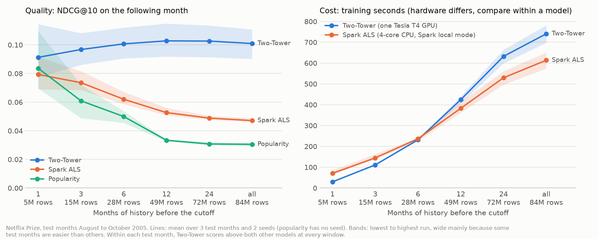
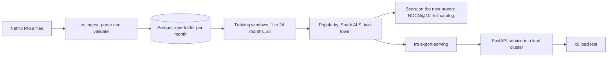

# temporal-recsys

[](https://github.com/navyasg0609/temporal-recsys/actions/workflows/ci.yml)

**How much history does a recommender need, and what does each extra month cost in compute?**

On the Netflix Prize ratings, the answer depends on the model. Popularity and ALS did best on
the most recent month: ALS on 1 month scored 1.68 times its all-history score and trained in about an
eighth of the time. A two-tower neural model needed about 6 months, which reached 98.0% of its
best score, and scored above both at every window. No model gained from history beyond 12 months.



*Scored on the month after each of three cutoffs in August to October 2005, against all 17,770
films. Bands span the lowest to highest run. Training times come from different hardware, so
compare them within a model.*

**Read more:** [report (PDF)](report/main.pdf) · [every number, with its run and commit](docs/CLAIMS.md) ·
[lab notebook](docs/LAB_NOTEBOOK.md) · [decisions](docs/DECISIONS.md) ·
[registered plans](experiments/registered/)

## Results

Mean NDCG@10 over three test months, and two seeds for the trained models. Bold marks the history
each model needs: the shortest window within 5% of its best at every test month.

| Months of history | Training rows | Popularity | Spark ALS | Two-tower |
|---|---|---|---|---|
| 1 | 5.0M | **0.0837** | **0.0793** | 0.0913 |
| 3 | 15.1M | 0.0609 | 0.0736 | 0.0968 |
| 6 | 28.2M | 0.0500 | 0.0620 | **0.1007** |
| 12 | 49.2M | 0.0334 | 0.0527 | 0.1028 |
| 24 | 71.8M | 0.0308 | 0.0489 | 0.1026 |
| all | 84.3M | 0.0305 | 0.0471 | 0.1010 |

Two supporting studies measured the system around the models:

- **Spark on one machine.** Spark ALS needed all 4 threads of a Kaggle notebook to beat
  single-threaded NumPy ALS, by 7.9%. On 1 core it took 1.88 times as long.
- **Serving.** The model served from a three-node kind cluster scored the same as in the
  experiment (0.0993 against 0.0994), and met a 100 ms p95 target up to 400 simultaneous users on
  one laptop (Intel Core i7-1355U). A second copy of the service did not raise that limit.

Every plan was registered before it ran, and the predictions that failed are reported alongside
the ones that held.

## Reproduce

On any laptop with [uv](https://docs.astral.sh/uv/) installed, using synthetic data:

```
git clone https://github.com/navyasg0609/temporal-recsys.git
cd temporal-recsys
uv sync
uv run trs reproduce --sample
```

The first `uv sync` downloads the dependencies, including PyTorch and Spark, which takes a few
minutes. The run itself takes under a minute. It runs the method end to end on generated ratings
whose tastes change at a known month, and checks that the planted change is found. The full-data runs need the Netflix Prize files, which
are not redistributed here, and ran on free Kaggle notebooks: see
[docs/REPRODUCING.md](docs/REPRODUCING.md).

## How it works



- **Temporal split.** Training data is strictly earlier than test data, and tests assert it.
  Every window at a cutoff is scored on the same users with the same earlier films removed.
- **Models.** Popularity, preference ALS in Spark and in NumPy, and a two-tower model in PyTorch
  whose input comes only from the training window.
- **Serving.** One ranking function serves both the evaluation and the API, and a test checks
  they return the same lists.

| Folder | Holds |
|---|---|
| `src/temporal_recsys/` | data pipeline, models, evaluation, experiments, service, `trs` command |
| `tests/` | unit and integration tests, all on synthetic data |
| `experiments/` | registered plans and their committed results |
| `deploy/` | Dockerfile, kind cluster, Kubernetes manifests, k6 load test |
| `report/` | the report and the scripts that draw its figures |
| `docs/` | claims ledger, decisions, lab notebook, data card, model card |

## Data

Netflix released this data for the Netflix Prize competition in 2006, and it has since been shown
to allow re-identification of subscribers. This repository holds no ratings, no samples of them
and no model trained on them. See the [data card](docs/DATA_CARD.md) and the
[model card](docs/MODEL_CARD.md).

## License

MIT. See [LICENSE](LICENSE).
